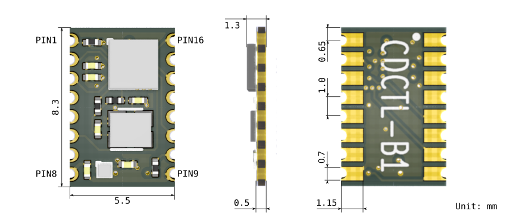
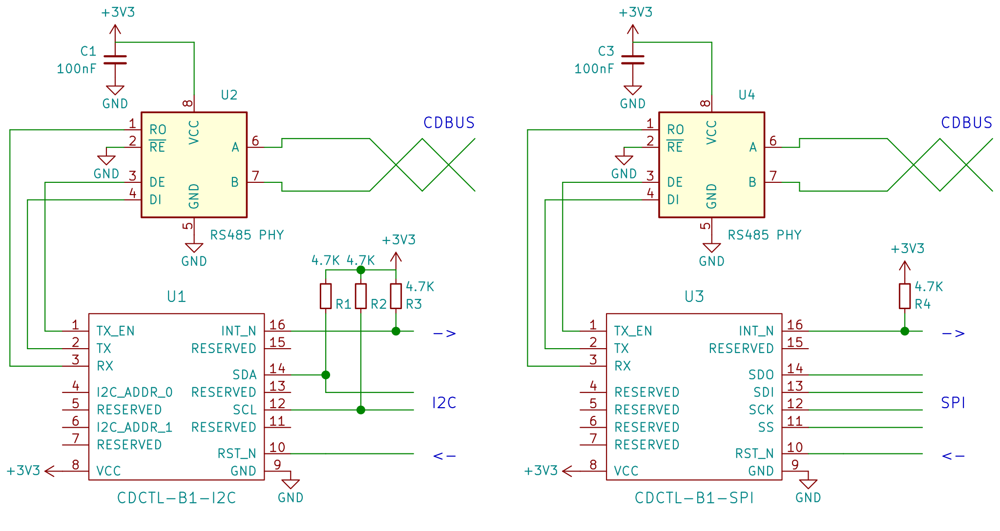

CDBUS IP Example
=======================================
This CDCTL-B (or CDCTL-H) module project integrates an SPI (or I<sup>2</sup>C) interface with the CDBUS IP core.  
The following sections describe the communication protocol used by the SPI and I<sup>2</sup>C interfaces.

  




## Chip-level Registers

The registers of the IP core are at 0x00 to 0x1f, the register address has one more bit for the registers of the chip:

| Register Name     |  Addr   | Access | Default         | Description                                          |
|-------------------|---------|--------|-----------------|------------------------------------------------------|
| INTF_CFG          |  0x38   | RD/WR  | 0x00            | Host interface configuration                         |
| PIN_RE_CTRL       |  0x39   | RD/WR  | 0x00            | RE pin control                                       |

**INTF_CFG:**

| FIELD   | DESCRIPTION                                                  |
|-------- |--------------------------------------------------------------|
| [5]     | INT pin pull-up: 0: disabled, 1: enabled                     |
| [4]     | INT pin output mode: 0: open-drain, 1: push-pull             |
| [1]     | SPI and QSPI: output the read data half a clock earlier      |
| [0]     | CRC mode, always 0 if built without `CD_CSR_CRC`             |

**PIN_RE_CTRL:**

| FIELD   | DESCRIPTION                                                  |
|-------- |--------------------------------------------------------------|
| [4]     | Output mode: 0: disabled (high impedance), 1: push-pull      |
| [0]     | Output value: 0: low, 1: high                                |

The pull-up of the INT pin and the RE pin are outputs of `cdctl_regs` only, they are not connected on the CDCTL-B module.


## SPI

Read or write depends on bit W/R̅:  
 - 0: Read
 - 1: Write

| FIELD   | DESCRIPTION         |
|-------- |---------------------|
| Ax      | Register address    |
| Wx      | Write data          |
| Rx      | Read data           |
| X       | Don't care          |

Read or write single byte:  


Burst read or write:  


## SPI with CRC

After bit0 of INTF_CFG (CRC mode) is set, every transfer carries the number of data bytes and a CRC.
The bit is set by a transfer as above and cleared by a transfer with CRC; it applies from the next transfer on.

| FIELD   | DESCRIPTION                                                                    |
|-------- |--------------------------------------------------------------------------------|
| CMD     | First byte as above: W/R̅ and register address                                  |
| N-1     | Number of data bytes minus one                                                 |
| CRC     | CRC-16/CCITT-FALSE (polynomial 0x1021, initial value 0xffff, MSB first) of all the bytes before it, high byte first |
| STATUS  | 0xf0 or 0x0f, toggles at each accepted write                                   |

```
Write   CMD  N-1  D0 ... D(N-1)  CRC_H  CRC_L
Read    CMD  N-1  STATUS  D0 ... D(N-1)  CRC_H  CRC_L
```

The host sends CMD and N-1, the device drives SDO from STATUS on,
so SDO and SDI can be tied together (3-wire SPI) as without CRC mode.

Write:
 - A register takes exactly one byte (N-1 = 0), and only after the CRC has been checked.
 - DAT and DAT_HOLD take up to 256 bytes, written to the page as they arrive; the page is not submitted if the transfer is rejected.
 - A transfer is rejected if the CRC is wrong, if it ends before the last CRC bit, or if a register gets more than one byte.
   Bytes after the CRC are ignored.
 - Read any register after each write: if STATUS has not toggled, the write was rejected.

Read:
 - A read neither clears nor releases anything in CRC mode (see `csr_crc_en` in the main Readme).
 - STATUS is two complementary patterns, anything else is a transfer error.

A failure is a read with a wrong CRC or STATUS, or a write without STATUS toggled.
The command of a failed transfer may have been taken as another one, e.g. a write of CTRL as a write of DAT_HOLD,
so after a failure, read until STATUS is valid to know the result of the last write, then take what spans transfers as lost:
 - The read position of the RX page: write RX_ADDR before reading the page again.
 - The TX page being written: write bit2 of CTRL and write the whole frame again;
   if no frame is being written, write bit2 of CTRL before the next one.
   Bit2 also drops a frame waiting to be sent, write it only while bit4 of INT_FLAG_L is 1.
 - A high byte not yet followed by its low byte: write the high byte again.

```python
    def crc16(data):
        crc = 0xffff
        for b in data:
            crc ^= b << 8
            for _ in range(8):
                crc = ((crc << 1) ^ 0x1021) & 0xffff if crc & 0x8000 else (crc << 1) & 0xffff
        return crc

    # RX
    flag, rx_len, _ = read(REG_INT_FLAG_L, len=3)   # repeat on CRC error
    if flag & 0x01:
        data = read(REG_DAT, len=rx_len+3)          # on CRC error: write(REG_RX_ADDR, [0]), read again
        write(REG_CTRL, [0x10])                     # release the page, check STATUS by the next read
    if flag & 0xce:
        write(REG_INT_FLAG_L, [flag & 0xce])        # clear the event flags seen
```


## QSPI

Four bits per clock on the four data lines, high nibble first.
The first byte is W/R̅ at bit7 and the register address at bit5 to bit0.

```
Write   CMD  D0 ... D(N-1)
Read    CMD  dummy  dummy  D0 ... D(N-1)
```

The host releases the data lines after CMD of a read, the device drives them from D0 on.

The read data is fetched ahead: a read of N bytes from DAT_HOLD moves the kept read position by N + 3,
write RX_ADDR before the next read of the same page.

In CRC mode, with the same CRC, STATUS and rules as for SPI:

```
Write   CMD  N-1  D0 ... D(N-1)  CRC_H  CRC_L
Read    CMD  N-1  dummy  STATUS  D0 ... D(N-1)  CRC_H  CRC_L
```

The host drives CMD and N-1, the device drives the lines from STATUS on. The dummy byte is not part of the CRC.
Exactly N bytes are fetched in CRC mode, so the read position kept by DAT_HOLD is not affected.

The mode is taken at the first clock of a transfer, so a transfer that starts within a few system clocks
after the write of INTF_CFG may still use the old mode: read INTF_CFG in the new format to confirm the change.


## SPI and QSPI timing

Limits relative to the system clock of the core (sysclk, 40 MHz on the CDCTL-B module):

|                                | SPI               | QSPI               |
|--------------------------------|-------------------|--------------------|
| SCK frequency                  | ≤ 1.4 × sysclk    | < 1 × sysclk       |
| NSS high between two transfers | > 1 sysclk period | > 2 sysclk periods |

To avoid:

 - Reading INT_FLAG right after a transfer that released or submitted a page, with NSS high for less than
   4 sysclk periods (SPI) or 5 sysclk periods (QSPI): the flags are still the old ones, read INT_FLAG once more.
 - QSPI without CRC mode: reading DAT or DAT_HOLD right after the transfer that released the page before it
   or wrote RX_ADDR, with the second rising edge of SCK less than 2 sysclk periods after NSS goes low.
   A transfer in between, such as the read of INT_FLAG, avoids it as well.


## I<sup>2</sup>C

| FIELD   | DESCRIPTION                                                     |
|-------- |-----------------------------------------------------------------|
| DAx     | I<sup>2</sup>C device address, DA0 and DA1 set by I2C_ADDR_x pins |
| Ax      | Register address                                                |
| Wx      | Write data                                                      |
| Rx      | Read data                                                       |
| X       | Don't care                                                      |
| D       | ACK by device                                                   |
| H       | ACK by host                                                     |
| N       | Host does not ACK after reading the last byte                   |

### Write


### Read

Write register address first, then read back:  


Burst read back:  


### CRC mode

With bit0 of INTF_CFG set, N-1, STATUS and the rules are the same as for SPI:

```
Write   S  DEV+W  ADDR  N-1  D0 ... D(N-1)  CRC_H  CRC_L  P
Read    S  DEV+W  ADDR  N-1  Sr  DEV+R  STATUS  D0 ... D(N-1)  CRC_H  CRC_L  P
```

 - The CRC covers all the bytes before it since the first start, both device address bytes and STATUS included.
 - The device does not ACK CRC_L of a rejected write.
 - A read follows ADDR and N-1 by a repeated start. After a write with data, nothing more is taken until the stop.

